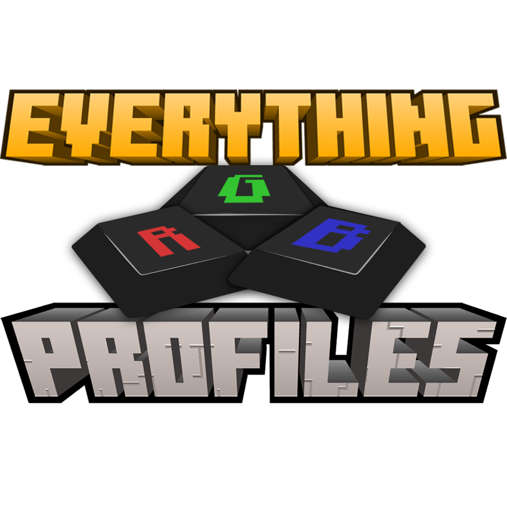

<p align="center">
  
</p>

<p align="center">
  <b>Your keyboard finally knows what you're going through.</b>
</p>

<p align="center">
  <a href="https://www.curseforge.com/minecraft/mc-mods/everything-rgb-profiles">CurseForge</a> ·
  <a href="https://modrinth.com/mod/gxMzJO7d">Modrinth</a> ·
  <a href="https://github.com/Rexilyent/everythingrgbprofiles/issues">Issues</a>
</p>

---

Most RGB integrations give your keyboard one color per biome. Plains? Green. Desert? Sandy. It works, and someone had to do it first.

But your keyboard has a hundred-odd individually addressable lights, and we could not stop thinking about that. So instead of picking a color, Everything RGB Profiles draws the place you're in, the thing you're fighting and the trouble you're in, live, across the whole board. Inspired by Terraria's RGB support, which turned the keyboard into part of the game and ruined plain colors for us forever.

## What it does

- **Every biome gets its own scene, not just a tint.** Sunlight dapples through the jungle canopy, wind tears across the windswept hills, swamps bubble, oceans roll and the deep dark does its creepy little twinkle.
- **Bosses show up on your keys.** The Wither's three heads track separately and spit skulls across the board. The Ender Dragon spans the whole keyboard and breathes fire along the floor. The Elder Guardian charges its laser right at you. The Warden: you'll know.
- **Your situation, at a glance.** Low health, hunger, burning, lightning, rain, snow, raids marching across the bottom rows and a moon crossing the sky at night. Drowning? The water rises up the keyboard. Die, and blood runs down the keys until you respawn.
- **Portals that feel like travelling.** A spiral charges up, then carries you through in the other dimension's colors.
- **A title-screen theme**, because the menu deserves to feel included.

<details>
<summary>🎞️ A few of them in motion</summary>

**Jungle**


**Deep Dark**


**The Wither**


**The Ender Dragon, fire breath**


**Drowning**


**Nether portal**


The full gallery lives on the [CurseForge](https://www.curseforge.com/minecraft/mc-mods/everything-rgb-profiles) and [Modrinth](https://modrinth.com/mod/gxMzJO7d) pages.

</details>

## Supported hardware

| Software | Status |
| --- | --- |
| Corsair iCUE | Tested on real hardware |
| Razer Chroma | Supported, not yet tested on real hardware |
| Logitech G HUB | Supported, not yet tested on real hardware |
| SteelSeries GG | Supported, not yet tested on real hardware |
| OpenRGB (SDK Server on) | Supported, not yet tested on real hardware |
| ASUS Aura (via Armoury Crate) | Supported, not yet tested on real hardware |
| Wooting | Supported, no software needed, not yet tested on real hardware |
| MSI Mystic Light | Supported with a free SDK download from MSI (`/rgbprofiles msi` walks you through it), not yet tested on real hardware |
| Gigabyte RGB Fusion | Not possible natively. Use OpenRGB |
| Philips Hue | Wishlist, needs hardware to build |

Your lighting software just needs to be running. The CurseForge and Modrinth pages explain the MSI, ASUS, Gigabyte and Hue situations in full.

## Commands

| Command | What it does |
| --- | --- |
| `/rgbprofiles status` | What the mod thinks is going on with your lighting |
| `/rgbprofiles test` | A quick hardware check |
| `/rgbprofiles report` | Writes a diagnostics file to attach to an issue |
| `/rgbprofiles msi` | MSI's SDK download link and where the file goes |

On one of the untested backends? Congrats, you're a pioneer. 🎉 Run `/rgbprofiles report` and attach the file to an [issue](https://github.com/Rexilyent/everythingrgbprofiles/issues). It genuinely helps.

## Modpacks and other mods

A biome from another mod with no profile of its own still gets a color worked out from the biome itself, so a big modpack won't leave you staring at grey. Modded bosses get a boss effect of their own.

Some mods get hand-made lighting on top of that: Better End Island, Tough As Nails, The Aether, The Twilight Forest, Legendary Monsters and more, at various stages. The download pages have the current table. Got a mod you'd love to see on it? [Open a request](https://github.com/Rexilyent/everythingrgbprofiles/issues/new/choose).

## Make it yours

Every biome, boss and dimension is a line in a JSON file you can edit, colors and patterns both, and one wildcard line covers everything a whole mod adds. The rest lives in the regular config file. If your keyboard doesn't report its own layout, you can describe it yourself.

## Client-side only

Servers don't need it, and you can join any server with it installed, modded or vanilla. It doesn't send anything anywhere. The only thing it talks to is the lighting software on your own PC.

## Building from source

Each Minecraft version has its own branch, named `mc/<version>` (for example `mc/26.3`). Check out the one you want, then:

```
gradlew build
```

The jars land in `neoforge/build/libs` and `fabric/build/libs`. Gradle downloads the JDK it needs on its own.

A plain build is always a release build. Features that are still being tuned only switch on in an experimental build, which carries `-experimental` in its version:

```
gradlew build -Pexperimental_features=true
```

The [tuning tools](tuning/README.md) preview the lighting without launching Minecraft.

## Contributing

Bug reports, lighting problems, mod-compat requests and feature ideas all have a template on the [issue tracker](https://github.com/Rexilyent/everythingrgbprofiles/issues/new/choose). Pull requests are welcome too. Forking the repo to send one is fine under the license.

## Thanks

- [Dreips](https://github.com/Dreips), for discovering that effects aimed at a single key (the health and hunger warnings, for example) had no key to land on with a Logitech board.

## License

Everything RGB Profiles is **source-available, not open source**. You can read the code, change it for yourself and send changes back through pull requests. You can't re-upload or redistribute the mod or modified versions of it. Modpacks are welcome as long as they download the mod from an official page instead of bundling the jar. See [LICENSE](LICENSE) for the full terms.

- Includes Corsair's iCUE SDK runtime, unmodified, which belongs to Corsair and is redistributed with permission.
- Includes Wooting's RGB SDK (v1.8.0), unmodified, under the Mozilla Public License 2.0. Source: [github.com/WootingKb/wooting-rgb-sdk](https://github.com/WootingKb/wooting-rgb-sdk).
- Not affiliated with Mojang, Microsoft, Corsair, Razer, Logitech, SteelSeries, ASUS, MSI, Wooting, Gigabyte, Signify (Philips Hue), OpenRGB or Re-Logic.
